# Dagster 實作與操作紀錄

> 以 `dagster project scaffold --name dagster_server` 建立的練習專案，記錄如何在 Dagster 中設定 `dbt run` 作業、Assets、Schedules 以及呼叫外部 HTTP API 的 `op`。

## 1. 這份練習實際設定的檔案與畫面

在 `dagster_server/` 下主要修改與新增了以下四個檔案：

1. **執行 dbt 作業（[mydag.py](./dagster_server/mydag.py) 與 [__init__.py](./dagster_server/__init__.py)）**
   - 新增 `mydag.py` 設定執行 `dbt run` 功能，並在 `__init__.py` 的 `Definitions` 加入對應 `jobs`。
   - 網頁介面 `Deployment/dagster_server` 下的操作畫面與執行紀錄：
     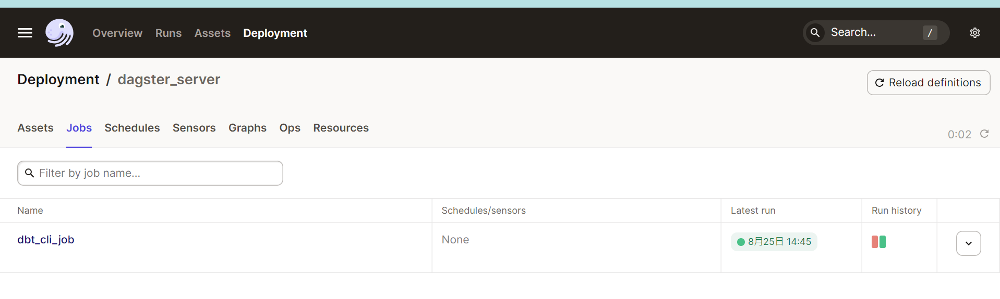
     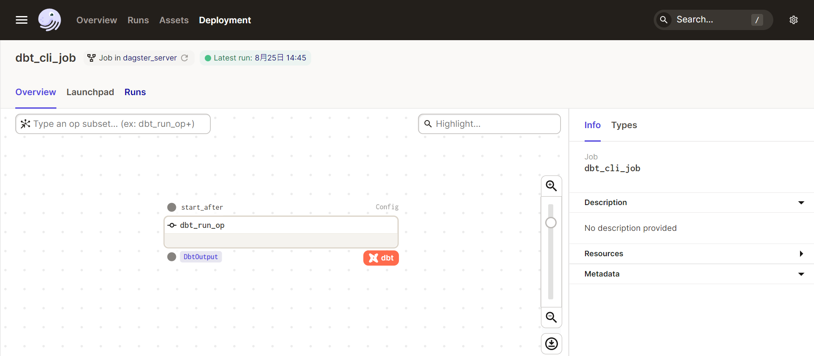
     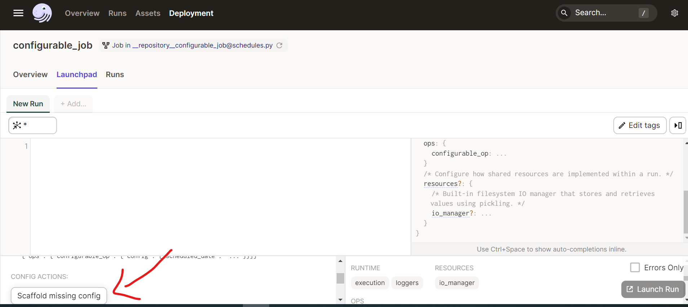
     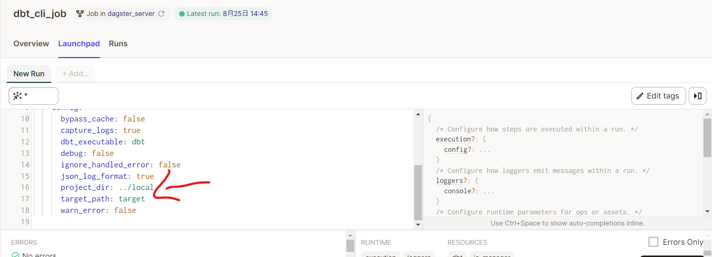
     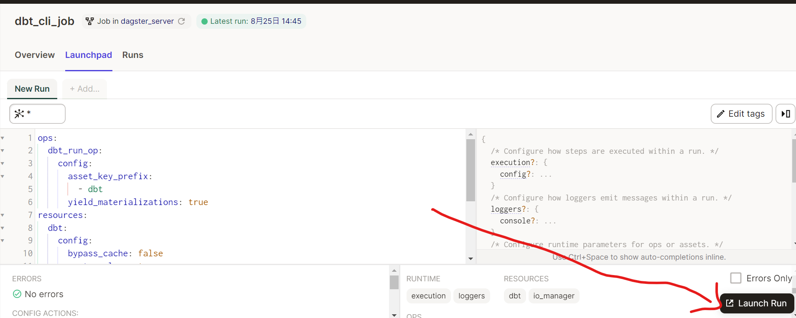
     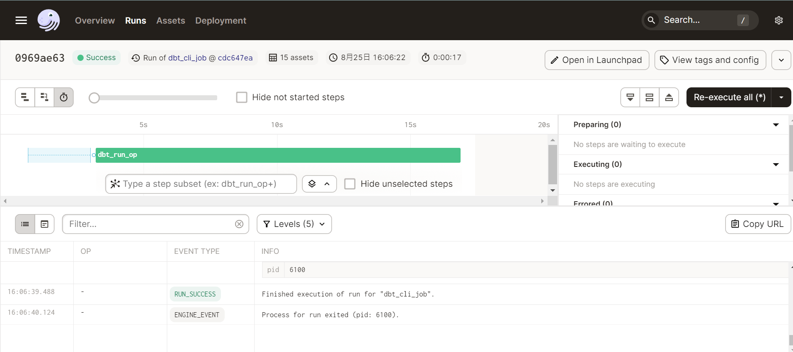
     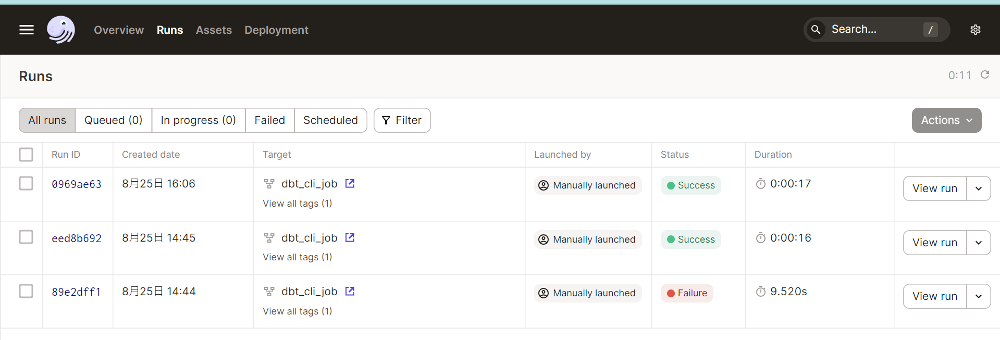

2. **Assets 設定（[assets.py](./dagster_server/assets.py)）**
   - 依 `__init__.py` 預設載入 Asset 定義與執行圖形紀錄：
     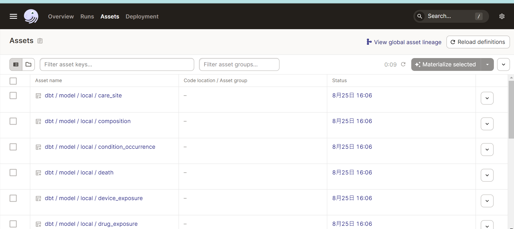
     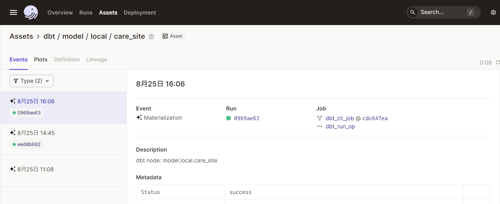
     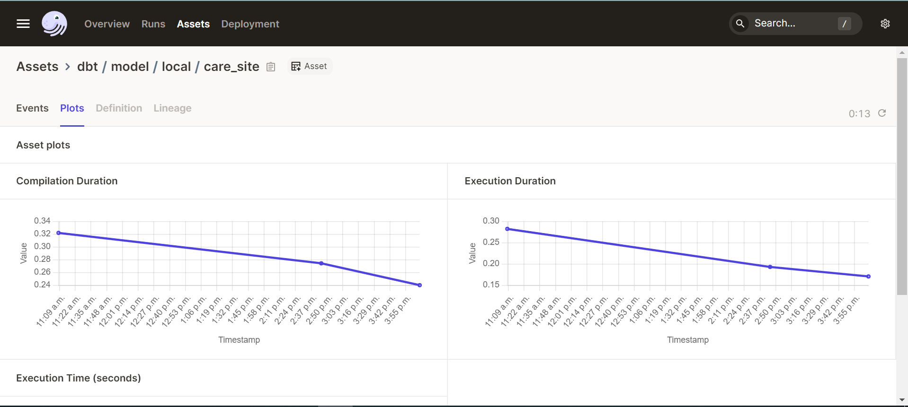

3. **排程設定（[schedules.py](./dagster_server/schedules.py)）**
   - 於 `schedules.py` 設定定時排程（亦可直接在 job 加上 `@schedule` 並於 `__init__.py` 註冊）：
     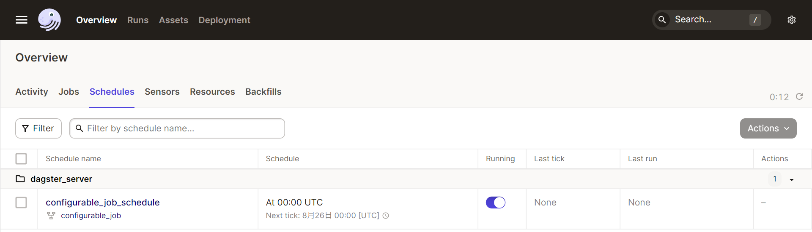
     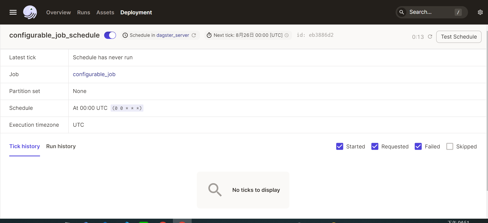

4. **串接外部 HTTP API（[api_link.py](./dagster_server/api_link.py)）**
   - 安排 3 個 `op` 分別呼叫外部容器 API（目前版本未強制順序）：
     - `call_api_op`：呼叫 `<your_ip>:<your_port>/test`
     - `call_api_op2`：呼叫 `<your_ip>:<your_port>/bucket_to_db`
     - `call_api_op3`：呼叫 `<your_ip>:<your_port>/dbt_exec`

- 參考文章：[Dagster 教學筆記](https://wdxtub.com/bigdata/bigdata-03/2023/06/16/)

---

## 2. 正式使用方式

### 步驟 1：安裝套件與設定環境變數
```bash
pip3 install dagster dagit dagster-dbt
pip install -e ".[dev]"

# Windows PowerShell 設定 DAGSTER_HOME
$env:DAGSTER_HOME = "...\dagster_server"

# Linux / macOS
export DAGSTER_HOME=".../dagster_server"
```

### 步驟 2：啟動服務與測試
```bash
# 單支腳本測試
dagit -f ./dagster_server/mydag.py

# 啟動完整 Dagster 開發服務（預設開啟 http://localhost:3000）
dagster dev

# 執行單元測試
pytest dagster_server_tests
```
